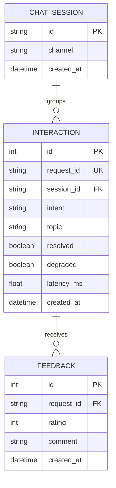

# Lab 5 — Data model worksheet

## 1. Critique of `bad_schema.sql`

| Problem | Why it hurts | Better design |
|---|---|---|
| `id` is not a primary key | Duplicate or missing identifiers cannot reliably identify an interaction. | Use a primary key, plus a unique `request_id` for feedback lookup. |
| Names, phone numbers and full messages are stored | Sensitive information is retained even though analysis needs only metadata. | Omit these fields; use a salted session hash and synthetic demo data. |
| Feedback ratings are a comma-separated string | Individual ratings cannot be constrained, joined or counted reliably. | Store one feedback row per rating, linked to a request; apply a rating constraint. |
| Intent values have inconsistent free-text spellings | Counts fragment across variants of the same intent. | Generate a consistent intent value at the application boundary and validate allowed values. |
| Human-formatted time is stored as text | Ordering and filtering can be ambiguous across formats and time zones. | Store UTC timestamps in a consistent representation and index when needed. |
| Latency includes a unit in text | Numeric averages and comparisons require fragile parsing. | Store numeric milliseconds as `latency_ms`; state the unit in the name. |

## 2. Store or not?

Retention below is a proposed policy for the group to decide; the current implementation does **not** automatically delete records.

| Data | Form | Proposed retention | Reason |
|---|---|---|---|
| Raw message | None | Not stored | Not needed for the lab's analysis. |
| Session ID | Salted hash | Until the team deletes the lab database | Group interactions without storing the raw identifier; the hash is pseudonymous, not anonymous. |
| Intent, latency, topic | Structured metadata | Until the team deletes the lab database | Supports aggregate queries; topic must not include free-form personal data. |
| Feedback rating | Structured integer | Until the team deletes the lab database | Evaluate feedback by interaction. |
| Feedback comment | Optional text | Until the team deletes the lab database | Useful context, but may contain personal data; demos use synthetic comments. |
| Student name or phone | None | Not stored | Unnecessary personal identifiers. |

## 3. Product questions

| Question | Fields and tables | Query sketch |
|---|---|---|
| Most failed intent? | `interaction.intent`, `resolved` | Count rows where `resolved = 0`, group by intent, sort descending. |
| Average response time by intent? | `interaction.intent`, `latency_ms` | Average latency grouped by intent. |
| Top unresolved topics? | `interaction.topic`, `resolved` | Count unresolved rows with non-null topic, group and sort descending. |

`resolved` currently follows the API's non-unknown-intent convention; fee validation errors may be counted as resolved. This limits the first and third analyses until the outcome contract is improved.

## 4. ER diagram

The diagram describes intended relationships. SQLite foreign-key enforcement is not enabled in PR #46's current engine, and the ORM-created feedback table does not enforce the migration's rating CHECK; these differences require team follow-up.
