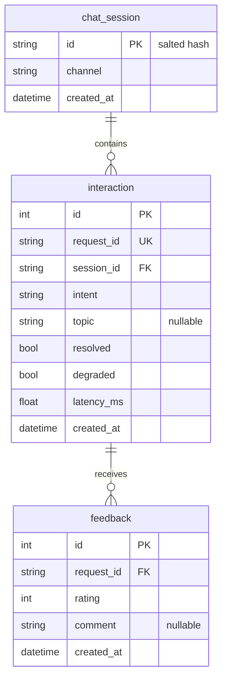

# Lab05 — worksheet mô hình dữ liệu và H3

Phần rà soát của Phan Quỳnh Quyền, hỗ trợ bởi Codex, ngày 13/11/2026. Nguồn:
bad_schema, migration 001 và worksheet học liệu tại `d795a1a09f430d83b0c69b45da1689984a1254b5`;
models nhóm đối chiếu nhánh Bảo tại `1f49c5458cae166bcf9076837aa72d71bac5cdeb`.

## 1. Bad schema và cách khắc phục

| Vấn đề | Hệ quả | Thiết kế tốt hơn / trạng thái thực tế |
| --- | --- | --- |
| `id INTEGER` không có PRIMARY KEY | Trùng ID, liên kết feedback không tin cậy | PK riêng cho session/interaction/feedback; request_id UNIQUE NOT NULL |
| Lặp thông tin phiên, tên và điện thoại ở từng chat | Dư thừa, cập nhật không đồng bộ, tăng bề mặt lộ dữ liệu | Tách session 1–N interaction; không lưu tên/điện thoại trong mô hình metadata |
| Feedback CSV như `'1,-1,1'` trong một ô | Khó lọc rating, đếm và gắn thời gian từng sự kiện | Tách feedback: mỗi hàng một sự kiện, FK request_id; CHECK rating trong migration |
| Latency text như `'120ms'` | AVG/sort dễ sai, phải tách chuỗi | latency_ms FLOAT; query trả ms, làm tròn khi trình bày |
| Time text như `'5/10/2026 9:03 PM'` | Mơ hồ ngày/tháng và timezone | UTC và định dạng thống nhất; SQLite có thể lưu thời gian dạng text, đổi tên kiểu cột chưa đủ |
| Raw message/answer và PII giữ vô hạn; intent tự do | Dữ liệu không cần cho analytics; fee/Fee bị tách nhóm | Chỉ metadata và salted hash; chuẩn hóa intent tại ứng dụng. Schema chưa CHECK vocabulary intent |

FK khai báo chưa đồng nghĩa mọi SQLite connection kiểm tra FK. Starter và engine
nhóm đang đối chiếu chưa bật `PRAGMA foreign_keys = ON`; R1 vẫn phải kiểm tra request.
`init_db()` ORM không có CHECK rating tương đương migration. `CREATE TABLE IF NOT
EXISTS` không sửa bảng có sẵn. Phần SQL này không đổi schema/engine của Bảo và Minh.

## 2. Lưu dữ liệu và retention

Thời hạn sau là **đề xuất cho nhóm**, chưa có job tự xóa trong bài này.

| Dữ liệu | Lưu? / hình thức | Retention đề xuất | Lý do |
| --- | --- | --- | --- |
| Raw user message / answer | Không | Không lưu | Analytics hiện tại không cần nội dung |
| Session ID | Có, SHA-256 có salt, lấy 16 ký tự hex | 30 ngày | Gom interaction; vẫn có khả năng liên kết, không gọi là vô danh tuyệt đối |
| Intent, latency, topic, outcome | Có, metadata | Chi tiết 30 ngày; tổng hợp tối đa 90 ngày | Tính F1–F3/H2 |
| Feedback rating | Có, số -1/0/1 | 30 ngày | Phân tích sự kiện theo request |
| Feedback comment | Có thể lưu text tối đa 500 ký tự | Tối đa 30 ngày, cân nhắc ngắn hơn | Có thể chứa PII; demo dùng comment giả lập; API chưa tự khử PII |
| Student name / phone | Không | Không lưu | Không cần cho analytics của lab |

Khi xóa chi tiết, xử lý feedback trước interaction rồi session để tránh mồ côi.
Salt chạy thật nằm ngoài Git/log và phải giữ ổn định qua restart.

## 3. Câu hỏi sản phẩm → trường / query

| Câu hỏi | Trường / bảng | Query sketch |
| --- | --- | --- |
| Intent chưa giải quyết nhiều nhất? | interaction: intent, resolved | GROUP BY intent; SUM(CASE WHEN resolved=0 THEN 1 ELSE 0 END); xem count và tỷ lệ H2 |
| Latency trung bình theo intent? | interaction: intent, latency_ms | AVG(latency_ms) GROUP BY intent (F2) |
| Topic unresolved nhiều nhất? | interaction: topic, resolved | WHERE resolved=0 AND topic IS NOT NULL; GROUP BY topic; COUNT(*) DESC |
| Topic nhận nhiều thumbs-down? | feedback: request_id, rating; interaction: request_id, topic | JOIN request_id; rating=-1; topic IS NOT NULL (F3) |

Unresolved và thumbs-down là hai tín hiệu khác nhau; không thay resolved bằng rating.

## 4. ER của metadata assistant

Feedback tham chiếu **request_id duy nhất**, không phải interaction.id. Mỗi request
có thể nhận nhiều feedback; F3 đếm sự kiện. FAQ và schema_version là bảng bổ sung
của Part F, không thuộc ba entity metadata trong sơ đồ này.
